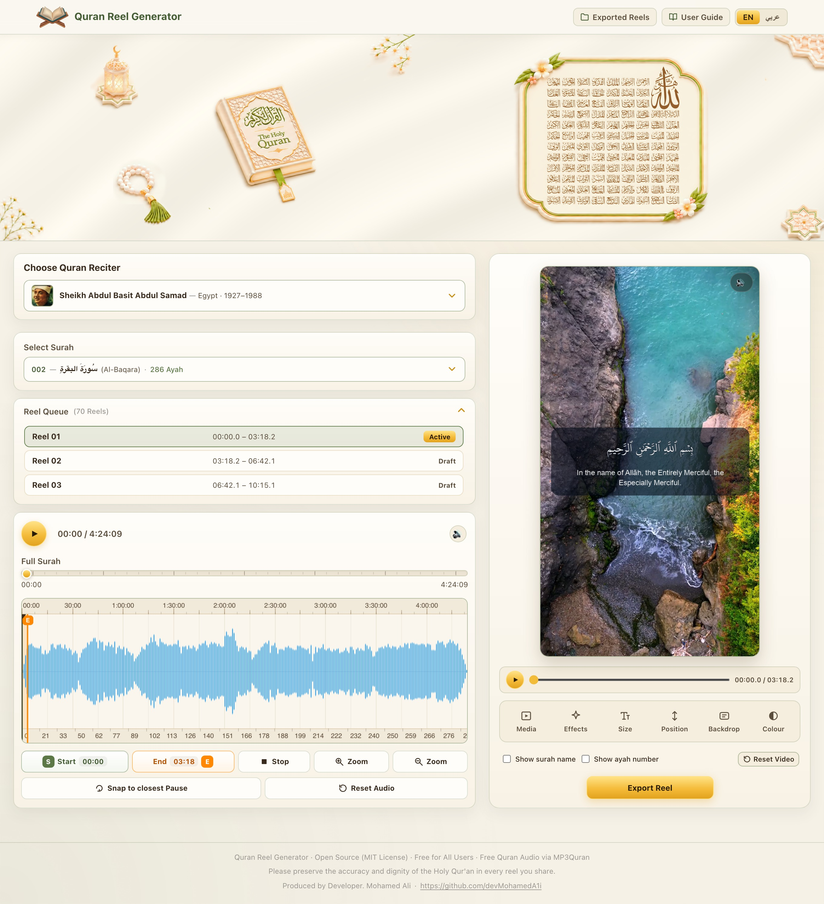
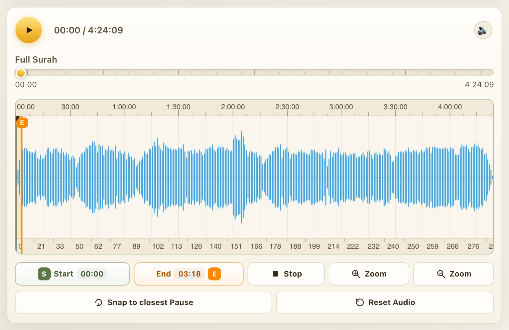
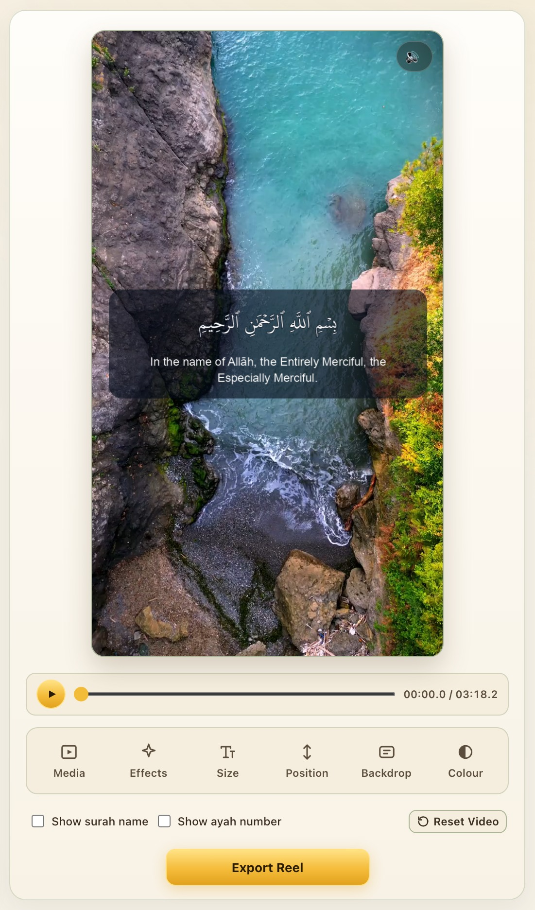
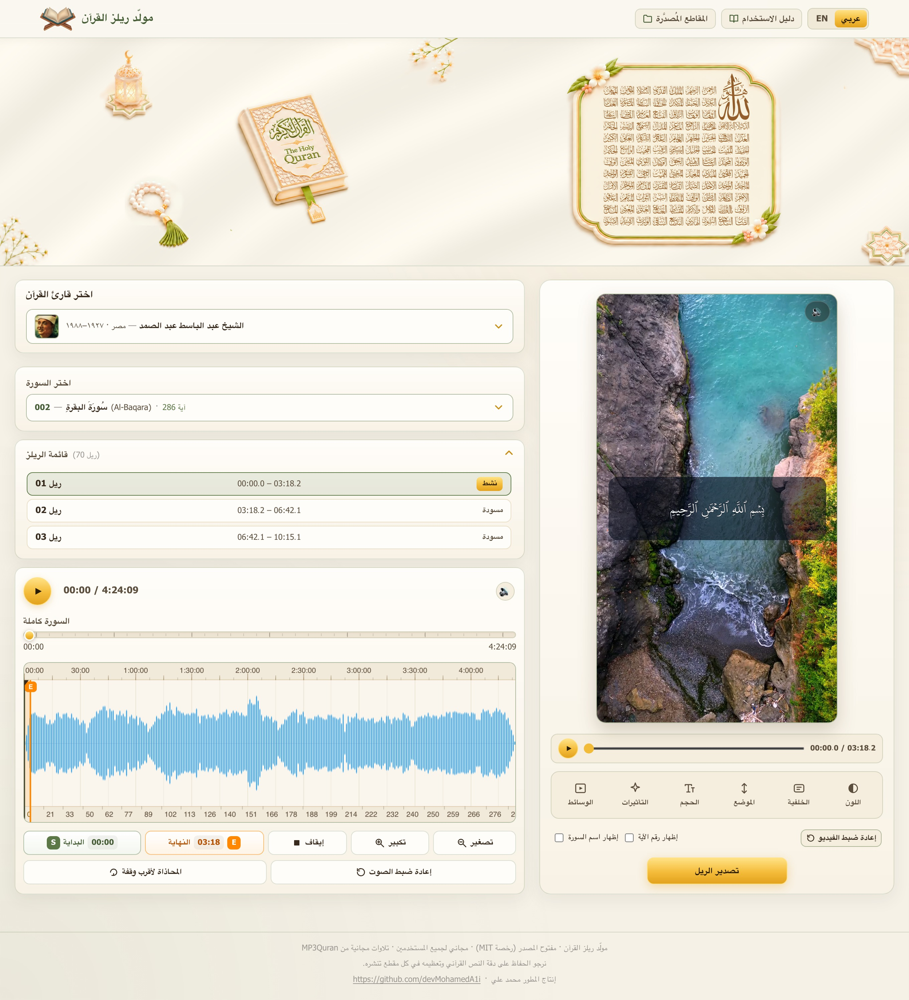

# Quran Reel Generator — مولّد ريلز القرآن

[](LICENSE)
[](#macos)
[](#windows)
[](#android-apk)
[](https://devmohameda1i.github.io/Quran-Reel-Generator/)
[](#security--privacy)

**English** · **[العربية](#arabic)**

Create synchronized **9:16 vertical Quran reels** (`720×1280` H.264/AAC MP4) completely locally on your computer — **100% free, open source, no watermarks, no accounts, and no cloud uploads.**



---

## Key Features

- **10 Renowned Reciters (Surah Al-Fatihah Ready Out of the Box + All 114 Surahs on Demand):** Try any of the 10 reciters immediately with Surah Al-Fatihah pre-loaded, and download all 114 Surahs in 1 click directly from **MP3Quran** — works 100% offline afterward.
- **Verified Uthmani Script + Bilingual Support (`EN` / `عربي`):**
  - Authentic **KFGQPC Uthmani Hafs v18** Arabic text rendered via **Pillow + HarfBuzz/FriBidi (RAQM)** for crisp tashkeel/diacritics.
  - Optional **Saheeh International** English translation (`QuranEnc.com`) alongside the Arabic verse.
  - Toggle **Show surah name** and **Show ayah number** in both Arabic and English.
- **Automatic 3-Minute Surah Splitting & Precision Waveform Editor:**
  - Automatically divides any full Surah into ready-to-export **~3-minute Ayah-aligned reels** in the **Reel Queue** list — ready to pick and export in order with zero gaps.
  - Easily **adjust any reel's length** from the **Audio Editing (Waveform)** section: drag the green **S** (Start) and orange **E** (End) handles directly on the waveform, zoom in/out, and tap **Snap to closest Pause** so recitations never cut mid-word.
  - Auto-rebalancing **Reel Queue** keeps multi-reel Surahs continuous whenever you shorten or extend a clip.
- **Live 9:16 Video Studio & 1-Click Export:**
  - 3 built-in starter HD backgrounds (`Sample1`, `Sample2`, `Sample3`) plus 1-click upload for your own videos/images, with **smooth crossfaded seamless looping**.
  - **Inter-ayah pause detection** fades text gently between verses without flickering mid-ayah.
  - Stackable visual effects (Fade speeds, Slow Zoom/Pan, Warm, Golden, Night, Dim, Vignette, Soft Focus, Crisp, Monochrome) plus font Size, Position, Backdrop opacity, and Colour.
  - **1-click Export Reel** with live in-button progress, **Cancel** button (stops FFmpeg cleanly), and automatic green **✓ Exported successfully** confirmation.
- **Full Arabic RTL & English UI:** Switch seamlessly between **EN** and **عربي** at any time.

| Waveform Editor | 9:16 Video Studio | Arabic RTL Mode |
| :---: | :---: | :---: |
|  |  |  |

---

## Download & Install

No Python, no FFmpeg, no Terminal, and no Chrome required — everything is bundled inside a single native desktop app.

### iPhone & Android (Free Mobile Web App)

Open directly in your phone's browser — **no App Store, no downloads required, 10 built-in HD vertical backgrounds, automatic 3-minute Surah splitting, and 100% on-device MP4 export**:

👉 **[https://devmohameda1i.github.io/Quran-Reel-Generator/](https://devmohameda1i.github.io/Quran-Reel-Generator/)**

https://github.com/user-attachments/assets/55c89b3b-2603-4fea-9b6c-2915b70576ab

### iPhone (Safari)

1. Open **[https://devmohameda1i.github.io/Quran-Reel-Generator/](https://devmohameda1i.github.io/Quran-Reel-Generator/)** in **Safari**.
2. Tap **`≡`** on the left of the bottom address bar *(or Share `↑` on older iOS)* → **Share** → **Add to Home Screen** → **Add**.
3. Launch **Quran Reels** from your Home Screen to run it full-screen like a native app.

### Android (.apk)

1. Download the standalone Android app directly:
   👉 **[Download Quran-Reel-Generator-Android.apk](https://github.com/devMohamedA1i/Quran-Reel-Generator/releases/latest/download/Quran-Reel-Generator-Android.apk)**
   *(Or open the web app and tap **`ⓘ`** → **Download Android App (.apk)**.)*
2. Tap **Open** on the download notification and tap **Install** *(Android may ask once to allow installing from your browser)*.
3. Exported MP4 reels save directly to your phone or share straight to WhatsApp, Instagram, TikTok, and YouTube Shorts.

### macOS

1. Go to the **[Releases](../../releases)** page and download **`Quran-Reel-Generator.dmg`** (Apple Silicon Mac).
2. Double-click **`Quran-Reel-Generator.dmg`** and drag **Quran Reel Generator.app** into **Applications**.
3. Open **Quran Reel Generator** from **Applications**.
   > **First launch on macOS:** Because this is a free, unsigned open-source app, macOS may ask to confirm opening it the first time — simply **Right-click → Open** (or allow it once in *System Settings → Privacy & Security*).
4. Pick any of the **10 renowned reciters** inside the app to download their recitations on demand from **MP3Quran**.
5. Exported MP4 reels are saved automatically to **`~/Movies/Quran Reel Generator/`**.

### Windows

1. Go to the **[Releases](../../releases)** page and download **`Quran-Reel-Generator-Windows.zip`** (Windows 10/11, 64-bit).
2. Extract the zip folder and launch **`Quran Reel Generator.exe`** (uses Edge WebView2 + bundled static `ffmpeg.exe`/`ffprobe.exe`).
3. Exported MP4 reels are saved automatically to **`%USERPROFILE%\Videos\Quran Reel Generator\`**.
4. Developers can also build locally on Windows 10/11 via [`scripts/build_windows.ps1`](scripts/build_windows.ps1):
   ```powershell
   powershell -ExecutionPolicy Bypass -File scripts\build_windows.ps1
   ```

---

## Run from Source (Developers)

Requires **Python 3.10+**, **Node.js 18+**, and **FFmpeg/FFprobe** on `PATH` (plus `fribidi` on macOS for Pillow RAQM).

```bash
# 1. Build frontend
cd frontend && npm ci && npm run build && cd ..

# 2. Set up Python environment
python3 -m venv .venv
.venv/bin/python -m pip install -r requirements.txt

# 3. Verify setup & run
.venv/bin/python scripts/preflight.py --skip-data
.venv/bin/python app.py
# Open http://127.0.0.1:5055/
```

Run the test suite:
```bash
.venv/bin/python -m pytest -q
```

---

## Security & Privacy

- **100% Local:** Binds strictly to `127.0.0.1` (localhost only — never exposed to your network).
- **Zero Telemetry:** No analytics, no accounts, no cloud uploads, and no background processes left running after you close the window.
- **Verifiable Releases:** GitHub Releases include `SHA256SUMS.txt` for download integrity verification.

---

## License & Quran Content Attribution

- **Software:** Free and open source under the **[MIT License](LICENSE)**.
- **Quran Recitations:** Free-to-use Quran audio sourced on demand from **[MP3Quran](https://mp3quran.net/)**.
- **Arabic Script & Font:** Verified **KFGQPC Uthmani Hafs v18** text and font — please preserve the accuracy and dignity of the Holy Qur'an in every reel you share.
- **English Translation:** **Saheeh International** via **[QuranEnc.com](https://quranenc.com/en/browse/english_saheeh)** (Noor International Center), credited in exported MP4 metadata.
- See [THIRD_PARTY_NOTICES.md](THIRD_PARTY_NOTICES.md) for complete third-party notices.

> If you notice anything not working correctly, or if you think I made a mistake in any part of the app, please don't hesitate to contact me at **dev.mohamed.ali1@gmail.com** to enlighten me — your feedback helps keep this tool accurate and beneficial for everyone.
>
> *Jazakum Allahu khayran wa ja'alahu fi mizan hasanatikum*

<p align="center"><em>Do not forget us in your sincere prayers.</em></p>

---

<a id="arabic"></a>

## العربية — مولّد ريلز القرآن

<div dir="rtl">

تطبيق سطح مكتب **مجاني 100% ومفتوح المصدر** لإنشاء **ريلز قرآنية عمودية 9:16** (`720×1280` بصيغة H.264/AAC MP4) محلياً بالكامل على جهازك — **بدون علامات مائية، بدون حسابات، وبدون رفع أي ملفات للسحابة.**


### أبرز المميزات

- **10 من كبار القراء:** سورة الفاتحة جاهزة للتجربة فوراً، وتحميل كامل المصحف (114 سورة) بنقرة واحدة من **MP3Quran**.
- **خط عثماني مُحقق ودعم ثنائي اللغة (`عربي` / `EN`):** خط **مجمع الملك فهد (Uthmanic Hafs v18)** مع تشكيل دقيق عبر **Pillow + HarfBuzz/FriBidi (RAQM)**، وخيار إظهار الترجمة الإنجليزية (صحيح إنترناشونال) واسم السورة ورقم الآية.
- **تقسيم تلقائي للسورة إلى ريلز 3 دقائق + محرر موجة صوتية دقيق:** يُقسّم التطبيق السورة كاملة تلقائياً إلى مقاطع ريلز جاهزة (مدة كل منها ~3 دقائق متوافقة مع الآيات) في **قائمة الريلز**، ويمكنك **تعديل طول أي مقطع بحرية من قسم تحرير الصوت (الموجة الصوتية)** بسحب مقبضي البداية والنهاية، والتكبير والتصغير، وميزة **التقاط أقرب وقفة** حتى لا تنقطع التلاوة في منتصف الكلمة.
- **استوديو فيديو حي 9:16 وتصدير بنقرة واحدة:** خلفيات HD جاهزة (3 في تطبيق سطح المكتب و10 في تطبيق الجوال) + رفع خلفياتك الخاصة، تكرار سلس بتلاشي هادئ، تأثيرات بصرية قابلة للدمج، ومؤشر تقدم مباشر مع زر إلغاء نظيف.
- **تطبيق جوال مجاني للآيفون والأندرويد:** افتح **[https://devmohameda1i.github.io/Quran-Reel-Generator/](https://devmohameda1i.github.io/Quran-Reel-Generator/)** على الآيفون (Safari) أو حمّل تطبيق أندرويد المستقل (`.apk`) لتصدير مقاطع MP4 محلياً على هاتفك بدون متجر.
- **خصوصية كاملة 100% محلياً:** يعمل على جهازك فقط (`127.0.0.1`) بدون أي تتبع أو إنترنت أثناء التصدير.

### التحميل والتثبيت (iPhone و Android و macOS و Windows)

لا حاجة لتثبيت Python أو FFmpeg أو استخدام Terminal — كل شيء مُدمج داخل التطبيق مباشرة:

1. **لأجهزة iPhone (Safari):** افتح **[تطبيق الويب](https://devmohameda1i.github.io/Quran-Reel-Generator/)** في Safari ← اضغط **`≡`** (أو زر المشاركة `↑`) ← **مشاركة** ← **إضافة إلى الشاشة الرئيسية** ← **إضافة**.
2. **لأجهزة Android (تطبيق مستقل `.apk`):** حمّل التطبيق مباشرة عبر **[تحميل تطبيق أندرويد APK](https://github.com/devMohamedA1i/Quran-Reel-Generator/releases/latest/download/Quran-Reel-Generator-Android.apk)** *(أو من داخل تطبيق الويب عبر **`ⓘ`** ← تحميل تطبيق أندرويد)*، ثم افتح الملف واضغط **تثبيت** *(قد يطلب الهاتف السماح بالتثبيت من المتصفح مرة واحدة فقط)*.
3. **لأجهزة macOS و Windows:** افتح صفحة **[الإصدارات (Releases)](../../releases)** وحمّل ملف **`Quran-Reel-Generator.dmg`** (لأجهزة Mac Apple Silicon) أو **`Quran-Reel-Generator-Windows.zip`** (لأجهزة Windows 10/11).
4. **على macOS:** افتح ملف **`.dmg`** واسحب **Quran Reel Generator.app** إلى مجلد **Applications** ثم افتحه (لأول مرة: زر الفأرة الأيمن ← فتح).
5. **على Windows:** فك ضغط ملف **`.zip`** وشغّل **`Quran Reel Generator.exe`** مباشرة.
6. اختر أياً من **القراء العشرة** داخل التطبيق (سورة الفاتحة جاهزة فوراً، ويمكنك تحميل الـ 114 سورة بنقرة واحدة من **MP3Quran** والعمل بدون إنترنت بعدها).
7. تُحفظ المقاطع المُصدَّرة تلقائياً في مجلد الفيديوهات (`~/Movies/Quran Reel Generator/` على macOS أو `%USERPROFILE%\Videos\Quran Reel Generator\` على Windows)، وعلى أندرويد مباشرة عبر قائمة الحفظ والمشاركة.

### الترخيص والحقوق

- **البرنامج:** مجاني ومفتوح المصدر بموجب **[رخصة MIT](LICENSE)**.
- **التلاوات الصوتية:** تلاوات مجانية عبر **[MP3Quran](https://mp3quran.net/)**.
- **النص القرآني:** نرجو الحفاظ على دقة النص القرآني وتعظيمه في كل مقطع تنشره.

> إن لاحظت أي أمر لا يعمل كما ينبغي، أو رأيت أنني أخطأت في أي جزء من التطبيق، فلا تتردد في مراسلتي على **dev.mohamed.ali1@gmail.com** لتنبيهي — فملاحظاتك تساعد في إبقاء هذا العمل دقيقاً ونافعاً للجميع.
>
> **جزاكم الله خيراً وجعله في ميزان حسناتكم**

<p align="center"><strong>لَا تَنْسَوْنَا مِنْ صَالِحِ الدُّعَاءِ</strong></p>

</div>
